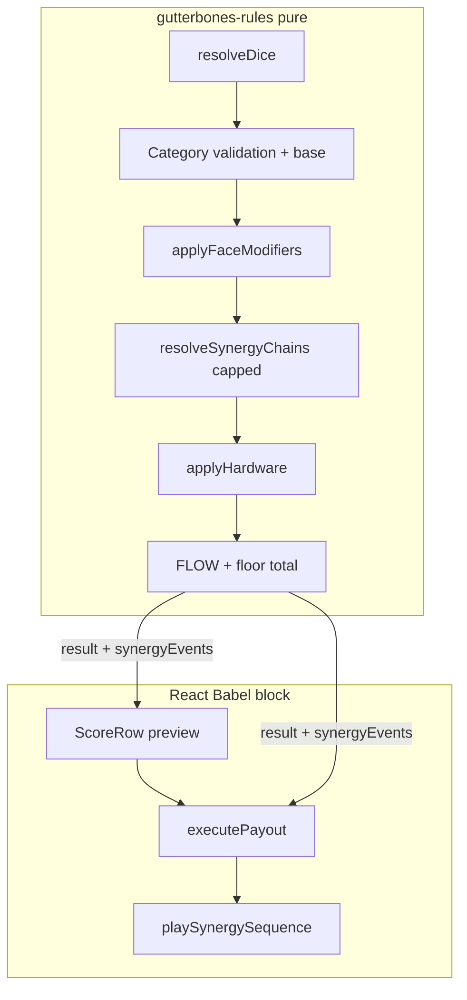

# Compounding synergies — phased implementation plan

**Branch:** `cursor/compounding-synergies-phased-d315`  
**Status:** Planning (implementation follows this document in order)  
**Scope:** Balatro-style compounding chains, event-driven juice, build-defining shop/path/meta choices — without breaking existing rules, saves, or CI.

**Related:** High-level design in the agent plan artifact; sensory constitution in [`ANIMATION_PLAN.md`](../ANIMATION_PLAN.md); test contract in [`testing.md`](../testing.md).

---

## Principles (non‑negotiable)

1. **Rules live in one place** — All scoring math stays in `<script id="gutterbones-rules">` inside [`index.html`](../../index.html). React only passes context and renders events.
2. **Green CI every merge** — Run `npm run check` before every push. No phase closes with failing tests.
3. **Backward-compatible saves** — New run/meta fields are optional; `normalizeSavedRun` defaults missing keys. Old saves must load and play.
4. **Baseline payouts frozen until intentional** — Standard category totals in [`tests/rules.test.cjs`](../../tests/rules.test.cjs) (Slop 15, Triad 40, …) must pass unchanged **unless** a phase explicitly rebalance-tests with documented intent.
5. **Feature flag first** — `SYNERGY_TUNING.enabled` (rules + UI) defaults `false` until Phase 1 sign-off; then default `true` with flag retained for emergency rollback.
6. **Explainability before juice** — Every synergy step appears in `explanationSteps`; animations/audio subscribe to the same event list.
7. **No Phase 7 module split** — Stay on the monolith per [`phase-7-module-split.md`](../phase-7-module-split.md) until synergy work ships.

---

## Architecture target



**New `calculateScore` return fields** (additive; old consumers ignore):

| Field | Purpose |
|-------|---------|
| `synergyEvents[]` | Ordered `{ kind, source, label, impact, chainIndex }` for UI/audio/tests |
| `chainDepth` | Max chain index + 1 (0 when disabled or no chains) |
| `retriggerCount` | Count of `kind: 'retrigger'` events |

Existing `triggers[]` remains for cascade badges; populate from synergy events where possible to avoid duplicate labels.

**Context extension** (wrapper at ~3873 in `index.html`):

```javascript
{ ..., synergyState, synergyTuning: SYNERGY_TUNING, synergyEnabled: SYNERGY_TUNING.enabled }
```

---

## Safety gates (use before closing each phase)

| Gate | Command / action |
|------|------------------|
| Unit + regression | `npm run check` |
| Source boundary | Tests in `tests/source.test.cjs` still find `GutterbonesRules.calculateScore` |
| Optional equivalence | `node tests/parity.cjs` when refactoring calculateScore structure (not required every commit) |
| Save round-trip | Add/update test in `tests/saves.test.cjs` when run shape changes |
| Manual smoke | `python3 -m http.server 8080` → score one hand, shop, carve (checklist in Phase 2+) |

**Rollback:** Set `SYNERGY_TUNING.enabled = false` and redeploy; chains and new shop weights no-op; baseline scoring matches pre-flag behavior if Phase 0 baseline tests pass.

---

## Phase 0 — Scaffold and lock baseline

**Goal:** Branch infrastructure, tuning object, tests that fail loudly if baseline drifts — **no player-visible behavior change**.

### Tasks

| # | Task | Files |
|---|------|--------|
| 0.1 | Add `SYNERGY_TUNING` constant next to `FLOW_TUNING` (`enabled: false`, `maxChainPasses: 8`, per-chain caps) | `index.html` Babel catalogs |
| 0.2 | Pass `synergyTuning` into `GutterbonesRules.calculateScore` context; rules ignore when `enabled === false` | `index.html` rules + wrapper |
| 0.3 | Add `tests/synergy-baseline.test.cjs`: re-run all standard payout rows from `rules.test.cjs` with `synergyTuning: { enabled: false }` | new test file |
| 0.4 | Document flag in [`AGENTS.md`](../../AGENTS.md) one line under gotchas | `AGENTS.md` |
| 0.5 | This plan doc committed on feature branch | `docs/plans/…` |

### Exit criteria

- `npm run check` green.
- With `enabled: false`, every existing rules test total unchanged.

### Commit message

`docs: add phased plan and synergy feature flag scaffold (disabled)`

---

## Phase 1 — Synergy engine + Tier 1 chains (rules only)

**Goal:** Compounding math behind flag; Tier 1 uses **existing** faces/hardware only.

### 1.1 Refactor rules (no new gameplay yet)

| # | Task | Detail |
|---|------|--------|
| 1.1a | Extract `applyCategoryBase`, `applyFaceModifiers`, `applyHardware` | Pure functions inside `gutterbones-rules` IIFE |
| 1.1b | Introduce `buildScoringContext(resolved, destroyed, catId, context)` | Holds running chips, mult, gDelta, events |
| 1.1c | Implement `resolveSynergyChains(ctx)` | Loop passes until no ops or `maxChainPasses`; each op appends `synergyEvents` + `explanationSteps` |
| 1.1d | Wire order: category → mastery → faces → **chains** → hardware → flow → total | Hardware after chains so Tier 1 “Crowbar cascade” can read chain state |

### 1.2 Tier 1 chain definitions (enable when `synergyTuning.enabled`)

| ID | Trigger | Effect | Cap |
|----|---------|--------|-----|
| `blood_ripple` | `BLOOD_6` scoring, adjacent blood/destructive | +1 mult per neighbor | +3 |
| `ghost_echo` | `GHOST_FACE` adjacent to `ECHO_FACE` | +1 mult once | 1 |
| `wire_feed` | `WIREBAG` adjacent to `GOLD` | Apply GOLD `gDelta` twice; WIRE penalty once | — |
| `engine_link` | ENGINE bonus ≥ 2 | +1 mult per `modifier`-type face showing | +4 |
| `bookends_retrigger` | BOOKENDS match | Re-apply face modifiers on slots 0 and 4 once | 1 retrigger |
| `crowbar_cascade` | CROWBAR gave mult & destroyed slot exists | +5 chips per destroyed slot that had destructive/blood | +25 |

**Design lock:** Crooked Cop disables **hardware** triggers only; **face + chain** steps still run (document in `explanationSteps` when hardware skipped).

### 1.3 Tests

| Test file | Cases |
|-----------|--------|
| `tests/synergy-chains.test.cjs` | Each Tier 1 chain in isolation with `enabled: true` |
| `tests/synergy-chains.test.cjs` | Chain cap: synthetic loop does not exceed `maxChainPasses` |
| `tests/synergy-chains.test.cjs` | `enabled: false` → identical totals to Phase 0 baseline |
| `tests/fixtures/runs.cjs` | Helpers `diceWithFaces([...])` for adjacency layouts |

### 1.4 UI (minimal)

| # | Task |
|---|------|
| 1.4a | Include `synergyEvents` / `chainDepth` in score breakdown payload when present |
| 1.4b | Score preview: optional second line “Chain depth N” when `chainDepth > 0` |
| 1.4c | **Do not** enable flag in production default until Phase 1 exit review |

### Exit criteria

- All Phase 0 + new synergy tests green.
- Manual: enable flag locally in dev, one blood-ripple hand shows extra steps in breakdown.

### Commits (suggested)

1. `refactor(rules): extract scoring helpers for synergy phase`  
2. `feat(rules): synergy chains tier 1 behind SYNERGY_TUNING flag`  
3. `test: synergy chain fixtures and tier 1 coverage`

---

## Phase 2 — Event-driven juice and audio

**Goal:** Players **feel** chains without changing math.

### Tasks

| # | Task | Files |
|---|------|--------|
| 2.1 | `playSynergySequence(events, { reducedMotion })` — stagger 120–180ms per event before heat-tier effects | `index.html` React |
| 2.2 | CSS: `.synergy-link` between bone slots (SVG or pseudo-elements); disable under `prefers-reduced-motion` | `index.html` styles |
| 2.3 | Category stamps: `Y`, `LS`, `FH` → `spawnPaperStamp` variant colors | `executePayout` |
| 2.4 | Preview: bone rim tint from hovered category; faster `score-row-ready` when `chainDepth >= 2` | ScoreRow + Bone |
| 2.5 | Audio: `chainStep(i, tag)`, `categoryStinger(catId)`, `retrigger()` in [`gutterbones-audio.js`](../../assets/audio/gutterbones-audio.js) | audio module |
| 2.6 | Wire `executePayout`: if `chainDepth >= 2`, call chain audio; category stinger on high categories | `executePayout` |
| 2.7 | Use or remove dead `payout()` API — either wire to retrigger or delete with comment | audio + AudioSystem shim |
| 2.8 | Update [`testing.md`](../testing.md) browser checklist: synergy sequence, reduced motion | docs |

### Exit criteria

- `npm run check` green (no new rules tests required if math unchanged).
- Manual recording: valid hand with `chainDepth >= 2` shows links + staggered breakdown.

### Commit

`feat(juice): synergy event sequence, link VFX, and category stingers`

**Enable default:** Set `SYNERGY_TUNING.enabled = true` after Phase 2 manual sign-off (single commit).

### Phase 2 follow-up (polish)

| # | Task | Detail |
|---|------|--------|
| 2.9 | `getScoreOverlayLifetimeMs` | Breakdown/resolution timers cover full chain stagger + tail (`overlayTailMs`, `overlayDepthBonusMs` when `chainDepth >= 2`) |
| 2.10 | Slot-aware preview tint | `categoryPreviewSlotActive` + stronger bone rim CSS; expanded `CATEGORY_PREVIEW_TINT` |
| 2.11 | Dev demo lane | Dev panel **LOAD SYNERGY DEMO LANE** (blood + shiv adjacent) for QA without shop carve |

---

## Phase 3 — Shop, paths, and carve UX

**Goal:** Choices steer builds; no new scoring items yet.

### 3.1 Run state

```javascript
nextShopTag: null | 'balanced' | 'hardware' | 'danger' | 'rare' | 'chaos'
routeModifiers: { flowCapDelta?: number, shopDiscount?: number, ... }
```

Normalize in `GutterbonesRules.normalizeSavedRun` + `tests/saves.test.cjs`.

### 3.2 Route → shop tag

| Path ID | Sets `nextShopTag` |
|---------|-------------------|
| `LOCAL` | `balanced` |
| `PAWN` | `hardware` |
| `SMUGGLE` | `danger` |
| `VIP` | `rare` |
| `HIDEOUT` | `balanced` (+ route modifier below) |

Apply tag in `generateShop()` weight tables (faces vs hardware vs rarity).

### 3.3 Route modifiers (quota/economy only first)

| Path | Modifier |
|------|----------|
| `HIDEOUT` | `flowCapDelta: -1` (implement as `min(maxStreak, FLOW_TUNING.maxStreak + delta)`) |
| `PAWN` | Next round quota +10% (via existing route quota mod), `shopDiscount: 0.15` |
| `SMUGGLE` | Grant random consumable (existing logic) + force `chaos` tag |
| `VIP` | Existing stash fill; add `informantWeight` for turf RNG (document in routes script) |

Single source: extend `gutterbones-routes` `PATHS` templates + `projectNextRound`; mirror in [`tests/routes.test.cjs`](../../tests/routes.test.cjs).

### 3.4 Shop UX

| # | Task |
|---|------|
| 3.4a | One offer slot uses `analyzeBuild().primary` + `ITEM_ARCHETYPE_TAGS` weighting |
| 3.4b | Static `SYNERGY_HINTS` map on shop cards (design data in Babel catalogs) |
| 3.4c | Carving: adjacency strip UI (slots 1–5), tooltip for blood/echo/wire |
| 3.4d | SHIV carve warning on slot 5 |

### Exit criteria

- Routes tests cover new modifiers and shop tag persistence on run.
- `npm run check` green.
- Manual: pick PAWN → shop skews hardware; HIDEOUT → lower FLOW cap visible in HUD.

### Commits

1. `feat(routes): route modifiers and next-shop-tag projection`  
2. `feat(shop): tagged generation and build-biased offer slot`  
3. `feat(carve): adjacency helper UI and shiv warning`

---

## Phase 4 — Tier 2 faces + meta unlocks

**Goal:** New carved faces that use the chain engine.

### New faces (`FACE_DATABASE`)

| ID | Behavior |
|----|----------|
| `FUSE_FACE` | Neighbor mult trigger → +10 chips |
| `MAGNET_FACE` | Scoring-only copy left `faceId` (after ECHO order — document in resolve order) |
| `MARK_FACE` | First score per category per round → +1 mult that category rest of run (`synergyState.categoryMarks`) |
| `DOUBLE_DOWN_FACE` | If category mult ≥ 3, ×1.25 mult (once per hand) |

### Meta / onboarding

| # | Task |
|---|------|
| 4.1 | Safehouse upgrade “Chain manual” → unlock Tier 2 face IDs in shop pool |
| 4.2 | `GutterbonesOnboarding.isShopFaceAvailable` gates by run count + purchase |
| 4.3 | Tests for each face + mark persistence in save |

### Resolve order (document in rules header comment)

1. `resolveDice` (ECHO, SHIV)  
2. MAGNET (scoring face copy)  
3. Category validation  
4. Face modifiers  
5. Synergy chains  
6. Hardware  
7. FLOW  

### Exit criteria

- New tests for each face; saves test for `categoryMarks`.
- Playtest note in `docs/` if quota adjusted (see Phase 6).

---

## Phase 5 — Tier 3 hardware + category synergies

**Goal:** Build-defining passives.

### New hardware (`DEVISES`)

| ID | Rule |
|----|------|
| `FUSE_BOX` | If ≥2 distinct face `type`s on table, +1 chain pass (raise effective cap by 1 once) |
| `MIRROR_RIG` | Before resolve, swap slot 2 ↔ 4 values; if equal after swap, +1 mult |
| `DEBT_COLLECTOR` | +0.5 mult per $1 debt (floor mult still 0.5) |
| `HOT_STREAK_COIL` | Retrigger highest mult-contributing face once if `flowStreak >= 1` |

Optional: hardware fields `categorySynergies: { Y: 'doubleFaceChips' }` — implement one example on **Weighted Core** (+20 instead of +10 on Triad when chains enabled).

### Tests

- Mirror rig swap does not mutate saved dice after score (immutable dice test pattern from rules.test.cjs).
- Debt collector with Crooked Cop hardware off vs on.

### Commit

`feat(content): tier 3 synergy hardware and category hooks`

---

## Phase 6 — Blueprints, combo meter, gamble hook

**Goal:** Run-long build contracts.

### 6.1 Blueprints

```javascript
run.blueprints: [{ id: 'MULT_ENGINE_START', consumed: false }, ...]
```

| Blueprint | Effect |
|-----------|--------|
| `MULT_ENGINE_START` | First MULT face each round retriggers once |
| `BLOOD_DEBT_START` | +1 debt at acquire; blood_ripple cap +1 |
| `FLOW_SAVE_ONCE` | First invalid hand per round does not reset FLOW |

Consume flags in `executePayout` / rules context; show chips in HUD near consumables.

### 6.2 Combo meter (optional split from FLOW)

- `synergyState.comboMeter`: +1 valid hand, −2 invalid; at 3/6/9 grant `heatSpikeNextHand: +0.25 mult` (tune in `SYNERGY_TUNING`).
- HUD meter beside FLOW badge.

### 6.3 Gamble

- Third option on gamble screen: “Blueprint flip” — same odds as FAIR tier; win grants random blueprint, lose stake.

### 6.4 Safehouse

- “Fixer’s network” → start run with one random blueprint.

### Tests

- `tests/gamble.test.cjs` extension for blueprint outcome.
- Save normalization for `blueprints`, `comboMeter`.

### Balance pass

- Run 3 scripted quota simulations (spreadsheet or small node script in `tests/` optional): rounds 7–10 average heat with synergies on.
- Adjust `SYNERGY_TUNING` caps before merge to main — document in commit.

---

## Phase 7 — Polish, docs, merge readiness

| # | Task |
|---|------|
| 7.1 | Wire `analyzeBuild` to use `history` chainDepth averages + item tags |
| 7.2 | Extend `BUILD_TIPS` with chain-aware strings |
| 7.3 | Shop refresh “tip the dealer” optional hint (if time; else defer) |
| 7.4 | Carve “reface swap” $8 once per shop (if time; else defer) |
| 7.5 | Final `npm run check`; update [`live-playtest-polish`](../live-playtest-polish-2026-10-29.md) or add synergy playtest section |
| 7.6 | PR to `main` with demo video artifact |

---

## File touch matrix ( cumulative )

| File | Phases |
|------|--------|
| `index.html` (`gutterbones-rules`) | 0–6 |
| `index.html` (Babel: shop, routes UI, carve, HUD) | 0, 1, 3–7 |
| `index.html` (`gutterbones-routes`) | 3 |
| `assets/audio/gutterbones-audio.js` | 2 |
| `tests/rules.test.cjs` | 0 (unchanged totals) |
| `tests/synergy-baseline.test.cjs` | 0 |
| `tests/synergy-chains.test.cjs` | 1+ |
| `tests/routes.test.cjs` | 3 |
| `tests/saves.test.cjs` | 3, 4, 6 |
| `tests/gamble.test.cjs` | 6 |
| `tests/fixtures/runs.cjs` | 1+ |
| `tests/helpers/game.cjs` | Only if new exports needed |
| `AGENTS.md` | 0, 7 |
| `docs/testing.md` | 2, 7 |

---

## PR strategy

- **One long-lived branch** `cursor/compounding-synergies-phased-d315` with **sequential commits per phase** (easier bisect).
- Optional: stack PRs phase-by-phase to `main` if review prefers smaller diffs — each phase PR must keep `SYNERGY_TUNING.enabled` false until Phase 2 completes, or true only after explicit enable commit.
- Do **not** merge with failing CI or with flag on without synergy test coverage.

---

## Open decisions (resolve in Phase 0/1 PR description)

1. **Default flag timing** — Recommended: enable globally in commit after Phase 2 manual QA.
2. **Quota rebalance** — Defer numeric quota changes until Phase 6 playtest; use caps on chain mult if sim shows round-10 trivializes.
3. **Deferred nice-to-haves** — Reface swap, tip-the-dealer refresh, persona signature chains (Counter) → Phase 7 or follow-up PR.

---

## Implementation checklist (track in PR)

- [x] Phase 0 complete (scaffold on branch; chains not implemented yet)
- [x] Phase 1 complete + Tier 1 tests (`SYNERGY_TUNING.enabled` still false until Phase 2 QA)
- [x] Phase 2 complete + enable flag (`SYNERGY_TUNING.enabled` true)
- [x] Phase 3 complete + routes/saves tests
- [x] Phase 4 complete + Tier 2 content
- [x] Phase 5 complete + Tier 3 hardware
- [x] Phase 6 complete + blueprints/gamble
- [x] Phase 7 complete + merge readiness (build intel, docs; tip-dealer / reface swap deferred)
- [ ] Merged to `main`
